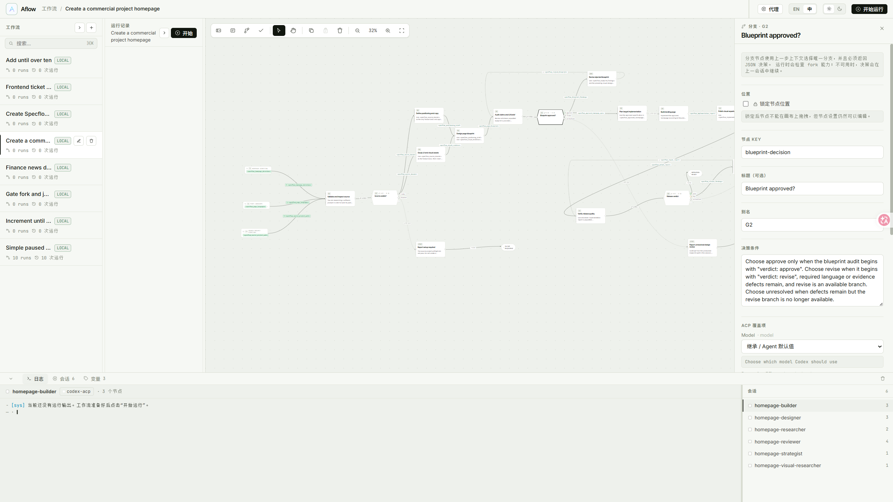
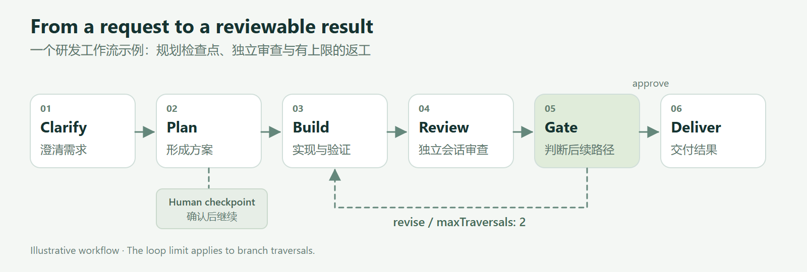
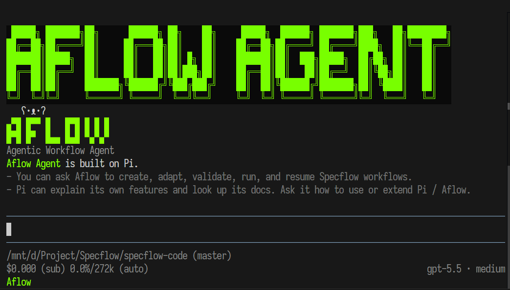
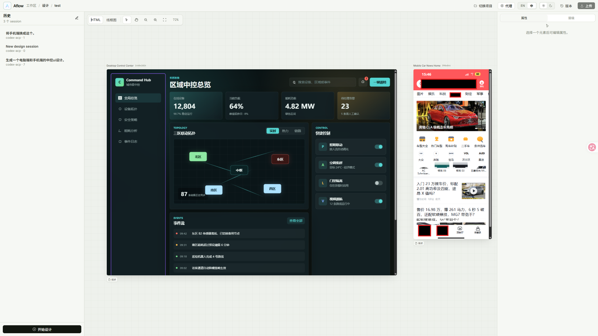
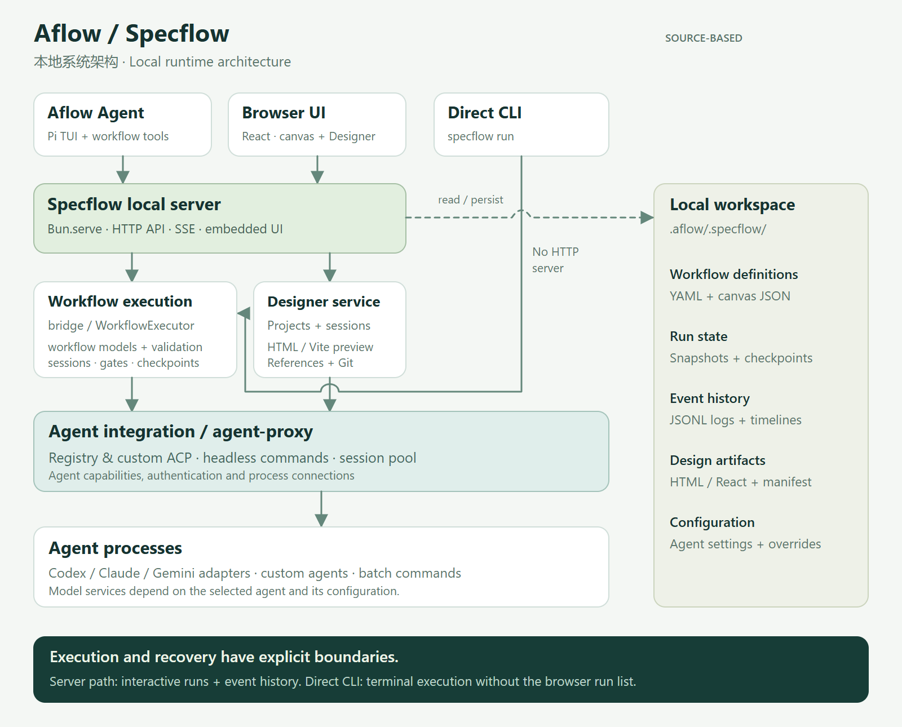

**Aflow / Specflow** 是一个围绕 AI Agent 工作流程构建的本地工具系统。它把任务拆成明确的步骤、会话、分支和人工检查点，让 Agent 的工作过程可以被编辑、观察、复用和继续推进。

项目由三个主要入口组成：**Aflow Agent** 负责通过对话设计和运行工作流；**Specflow** 提供工作流画布与执行基础设施；**Designer** 让产品和界面设计以可预览的 HTML / React 产物落地。三者围绕同一个本地 workspace 协作。

[项目官网](https://aflow.liuyifei.tech/) · [GitHub](https://github.com/DuGuYifei/Aflow) · [下载](https://github.com/DuGuYifei/Aflow/releases)

## 1. 项目定位：让 Agent 的工作过程可以复用

一次复杂任务通常包含需求澄清、方案设计、实现、测试、审查和返工。随着对话变长，任务中的约束、阶段性结论和未完成事项会变得难以追踪；换一个 Agent，往往又需要重新组织上下文。即使某次协作效果很好，也很难原样复用到下一个任务。

Specflow 将这些协作关系显式保存在工作流中：哪个 Agent 执行哪一步、哪些步骤共享会话、结果如何交给下一位参与者、什么时候需要人工判断，以及审查未通过时如何返回修改。

它适合需要明确过程与审查的研发、研究和业务任务。在软件开发场景中，可以把需求和约束整理为 spec 文档，支持 **Spec-Driven Development（SDD）**；在其他场景中，也可以通过自定义 Agent 组织资料收集、分析和报告审查等流程。

| 入口 | 面向的工作 | 主要产物 |
| --- | --- | --- |
| **Aflow Agent** | 对话澄清目标，创建、适配和运行 workflow | 可复用的工作流、执行结果、可继续的 Agent 会话 |
| **Specflow** | 编辑流程图，配置会话与分支，观察和控制运行 | Workflow YAML、运行快照、节点状态、日志 |
| **Designer** | 生成和迭代界面，结合参考项目与元素评论进行修改 | HTML / React 项目、多尺寸 frame、设计说明、本地版本 |

## 2. 核心功能：从流程编排到运行恢复

### 可视化画布与 Workflow-as-Code

Specflow 的画布展示工作流节点、连线、分支和会话，选中节点后可以调整 prompt、Agent 配置及其他属性。运行记录与日志和流程图放在同一个工作区，便于从某一步的结果回到它的执行上下文。


_Specflow 的实际界面：展示一个商业项目首页工作流，当前选中的是蓝图审查分支节点。_

工作流本身保存为 YAML。v2 格式用 `sessions`、`variables`、`nodes` 和 `edges` 描述执行关系，并区分 `start`、`step`、`gate` 和 `end` 节点。画布布局单独保存，因此工作流定义适合进入 Git，团队可以审查流程的变化，也可以手工编辑或让 Agent 生成工作流。

创建后先做结构校验，再开始执行。校验会检查节点连接、会话引用、循环约束和 Agent 能力等条件，例如包含人工暂停交互的节点需要使用支持交互会话的 Agent。

### 多 Agent、跨会话协作与上下文交接

每个执行节点可以关联一个 session，session 再关联具体的 Agent。连续的规划和实现步骤可以共享 builder 会话；审查步骤可以交给另一个 reviewer 会话，也可以选用不同的 Agent。

跨 session 的结果通过连线显式传递。`handoffPrompt` 描述需要提取哪些结果，`outputTag` 给输出命名，后续节点再通过 `<specflow_变量名>` 引用。这样可以为审查者准备变更摘要、验证结果和遗留问题，让交接内容与下一步的任务相匹配。

Agent 接入支持三种形式：从 registry 解析的 ACP Agent、自定义启动命令的 ACP Agent，以及执行命令式任务的 headless Agent。前两者通过 **Agent Client Protocol（ACP）** 连接；headless 路径适合无需会话交互的批处理。

### 分支判断与有上限的返工循环

审查结果可以进入 `gate` 节点，由配置的判断条件决定后续路径。例如：通过后交付，需要修改时返回实现，有阻塞时交给人工处理。

循环中的 gate branch 可以设置 `maxTraversals`，限定某条返工路径被经过的次数。流程因而能表达“审查后最多再修改两轮”这样的规则。上限约束的是分支经过次数，实际业务步骤可能因流程结构而有不同的执行次数。


_示意流程：规划后可设置人工检查点；审查结果控制交付或返工。图为概念说明，不是某次运行的截图。_

### 人工介入、运行控制与恢复

在需要人判断的步骤上设置 `pauseAfterRun: true`，节点完成后即可进入对应的 Agent 交互界面。用户能检查产物、补充信息，再继续推进流程。

Specflow 也明确区分了不同的控制动作：

| 操作 | 行为 |
| --- | --- |
| **Pause** | 请求在当前节点或检查点完成后的调度安全点暂停 |
| **Interrupt** | 立即打断当前 Agent turn，使本次 run 保持可继续 |
| **Play** | 继续同一个 paused / interrupted run |
| **Stop** | 终止整个 workflow run |
| **Continue** | 从 stopped / error run 的可恢复状态创建新的 continuation run |
| **Resume session** | 回到某个节点的 Agent 会话中继续工作 |

“继续流程”和“继续会话”分别对应调度状态与 Agent 上下文。工作流结束后，用户仍然可以选中某个节点的 session，通过 ACP 或受支持的原生 CLI 恢复路径继续打磨结果。可用的恢复方式取决于具体 Agent 的能力与已记录的会话信息。

## 3. Aflow Agent：用对话创建和维护流程

Aflow Agent 基于 **Pi agent harness** 构建终端交互体验，并接入 Specflow 的工作流工具。用户可以先讨论任务背景、输入输出和约束，再让它创建工作流，或者将已有通用流程 fork / adapt 为当前项目的版本。


_Aflow Agent 的实际终端界面。工作流工具与 Agent 对话处于同一个 TUI 中。_

常用操作包括创建、适配、校验、运行、Continue 和 session resume。运行前，Aflow 会收集缺失的必填变量；执行过程中，它会显示节点进度，并在需要人工交互时切换到相应会话。

新建和适配的流程可以先保存到 `agentflows-local/`，作为本地实验。稳定后再整理到共享的 `agentflows/`，让一次有效的协作过程成为可复用资产。

### Dynamic run：根据中间结果调整后续步骤

普通模式按照保存的工作流运行。**Dynamic run** 则在每次 activation（一次被调度的节点执行）之后暂停，由 Aflow 检查刚完成节点的文本输出；发现目标偏离、必要信息缺失或后续路径需要调整时，可以修改当前 run 的 snapshot，再继续到下一个检查点。

这里有三个关键对象：

- **Workflow YAML**：保存的流程定义，作为后续运行的起点。
- **Run Snapshot**：属于某次运行的工作流副本，可以在 paused / interrupted 状态下修改。
- **Checkpoint**：记录继续调度所需的状态，运行图修改时需要同步校验和迁移。

例如，审查发现实现前还缺少接口约束，可以在允许编辑的后续路径中补充澄清步骤。运行图修改会保留已经发生的历史事实，并检查它对未来可达节点的影响。循环中的节点即使执行过，也可能仍然属于后续流程。

Dynamic run 成功结束后，可以把最终快照另存为新的本地 workflow，将本次调整沉淀为下一次的流程版本。

## 4. Designer：把界面想法变成可迭代的产物

Designer 是同一个 Specflow server 提供的 `/design` 工作台。每个设计项目有自己的 Agent session、项目文件和版本记录，可以生成多个桌面或移动端 frame，并在画布里检查它们。


_Designer 的实际界面：在同一个画布中预览桌面与移动端产物。_

设计项目支持两种形式：**HTML 项目**适合快速探索，直接提供静态页面；**React 项目**使用由 Aflow 管理的 Vite 开发运行时。`manifest.json` 描述 frame 的尺寸、位置、页面文件或路由，以及关联的设计说明。

设计迭代围绕具体元素展开。预览 frame 中注入的 bridge 会把悬浮和选中的 DOM 元素传回父级 UI；元素、评论和视觉修改要求可以作为结构化上下文附加到聊天消息中。Agent 因而能结合用户选中的位置修改项目文件。

工作台还支持高保真与线框图视图、从 Git 或本地目录导入 reference，以及用本地 Git 提交保存设计版本。设计产物保留在项目目录中，可以作为后续实现的参考。

## 5. 技术架构：共享运行时，分离模型、执行与接入

本地核心采用 **TypeScript + Bun workspace monorepo**。前端使用 **React + Vite**，本地 HTTP 服务使用 `Bun.serve`，工作流模型、执行器和 Agent 接入分别放在独立 package 中。


_根据源码 package 和调用关系绘制的架构图。图中区分了 server 交互路径与 direct CLI 执行路径。_

### 分层与模块职责

| 模块 | 主要职责 |
| --- | --- |
| `packages/aflow` | Pi 终端 Agent、工作流工具、交互式变量收集、Dynamic run、会话恢复入口 |
| `packages/ui` | React 工作流画布、节点面板、运行日志、Designer；终端界面使用 xterm.js |
| `packages/cli` | `specflow` 命令、校验、direct CLI 执行入口 |
| `packages/server` | 本地 HTTP API、静态 UI、工作流与设计项目管理、运行数据持久化、SSE 事件流 |
| `packages/workflow` | 工作流图、节点、会话、prompt 和运行模型，以及结构校验 |
| `packages/bridge` | `WorkflowExecutor`、执行调度、交互与运行控制、session registry |
| `packages/agent-proxy` | Registry / custom ACP / headless 接入，连接、认证、能力发现与会话池 |
| `packages/native-resume` | 支持的原生 Agent 会话恢复方式与适配逻辑 |
| `packages/shared` | 跨 package 共享的数据类型、常量和工具 |

这样的拆分使流程规则与具体 Agent 的启动方式分离：工作流描述要执行什么，执行层安排步骤和上下文，接入层处理 Agent 进程与协议交互。Designer 使用自己的项目和会话服务，共享底层 Agent 接入能力。

### 一次运行如何推进

在浏览器或 Aflow 的 server 路径中，服务先读取和校验 workflow，解析本次变量与 Agent 配置，再把流程交给执行器。执行器选择当前节点的 session，通过 Agent 接入层发送任务，并根据结果、分支和运行控制状态安排下一步。

运行状态、Agent 事件和文本输出由服务端整理并持久化。浏览器通过 **Server-Sent Events（SSE）** 接收增量更新，也可以加载运行日志和历史事件回放。界面上的流程进度因此与底层执行记录关联起来。

`specflow run` 还有一条 direct CLI 路径：加载和校验 YAML 后直接调用执行器，在终端输出进度。这条路径不启动 HTTP server，也不接入浏览器运行列表和交互式 Pause / Play。需要人工暂停的工作流应通过浏览器或 Aflow 的 server 路径执行。

### 本地存储与构建分发

Workflow、画布、运行记录和设计产物主要保存在文件系统中。YAML 表达可复用流程，JSON 保存布局和运行状态，JSONL 保存追加式事件日志；Designer 的版本历史使用 Git。

前端经 Vite 构建后，静态资源会被纳入 Specflow 的二进制构建。Bun 将两个 CLI 入口编译成 `aflow` 和 `specflow` 可执行文件，由本地服务提供内嵌 UI。React 设计项目另外需要 Node.js 运行其 Vite 开发服务。

## 6. Workspace：区分共享定义与本地运行数据

项目文件集中在工作目录下的 `.aflow/.specflow/`：

```text
.aflow/.specflow/
├── agent-servers.json          # 团队共享的 Agent 启动配置
├── agent-servers.local.json    # 本机覆盖、个人路径和密钥
├── agentflow/
│   ├── agentflows/             # 可提交到 Git 的共享工作流
│   ├── agentflows-local/       # 本地草稿与适配变体
│   ├── canvas/                 # 浏览器画布布局
│   ├── assets/                 # 工作流附件
│   ├── runs/                   # 运行记录、快照与 checkpoint
│   └── run-logs/               # 运行事件日志
└── design/
    ├── projects/              # HTML / React 项目
    ├── references/            # 导入的参考项目
    ├── conversations/         # 设计会话与 timeline
    └── settings.json          # 本地设计设置
```

共享 Agent 配置与本机配置按 Agent ID 深度合并，团队可以共享启动方式，个人在本地补充认证环境与路径。初始化时会为本地草稿、画布和设计数据等生成忽略规则；整理团队流程时，主要审查共享 YAML 与共享配置。

“本地”描述的是编排、workspace 和产物管理的位置。具体 Agent 仍可能调用远程模型服务，其数据传输行为由所选 Agent 和模型配置决定。

### 与独立 Aflow Server 的边界

项目中还包含独立的 **Aflow Server** 团队协作工程，采用 Go DDD 模块化单体、React、PostgreSQL 和 Redis，面向项目管理、权限与工程协作。本文架构图描述的是 `aflow-specflow` 本地系统；其中的 **Specflow server** 指 Bun 本地服务，不依赖这套 Go 团队平台。两者的技术栈与部署边界应分别理解。

## 7. 使用入口

安装后的主要命令如下。工作流文件路径需要替换为自己保存的 YAML：

```sh
# Aflow 入口，可进入 Native Aflow、Specflow 或 Designer
aflow

# 启动本地 Specflow server，输出浏览器工作区地址
specflow

# 校验工作流，不执行 Agent
specflow validate .aflow/.specflow/agentflow/agentflows/code-review-flow.yaml

# 在终端执行无需人工暂停的工作流，并传入 task 变量
specflow run .aflow/.specflow/agentflow/agentflows/code-review-flow.yaml -Dtask="Review this change"
```

在实际研发中，可以先用 Designer 形成可预览的界面方案，再将需求澄清、实现和审查组织为 workflow；运行到关键步骤时由人确认，结束后继续进入相应 Agent session 处理细节。可复用的流程定义与每次运行的具体记录一起保留下来，为后续任务提供起点。

相关资料：[项目介绍与安装](https://github.com/DuGuYifei/Aflow) · [使用文档](https://aflow.liuyifei.tech/docs.html) · [版本下载](https://github.com/DuGuYifei/Aflow/releases)。文中产品截图取自项目官网素材，架构图与流程图依据本地源码和教程绘制。
