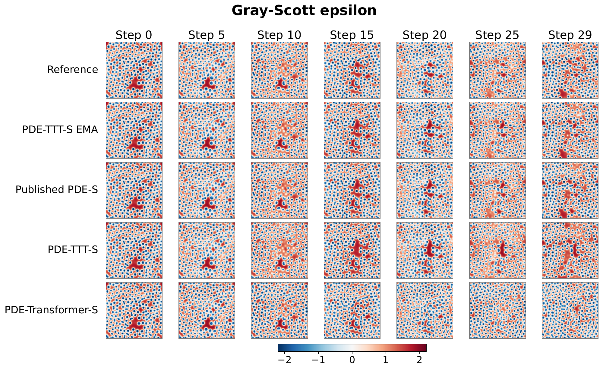
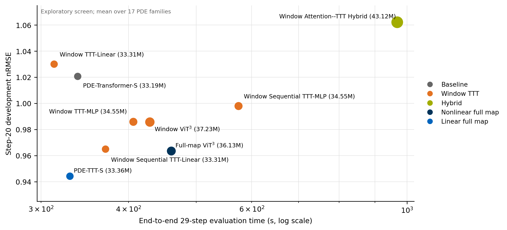
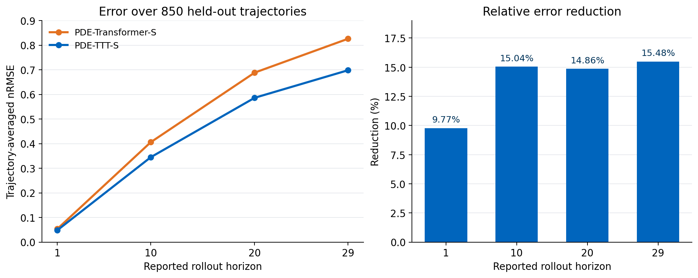
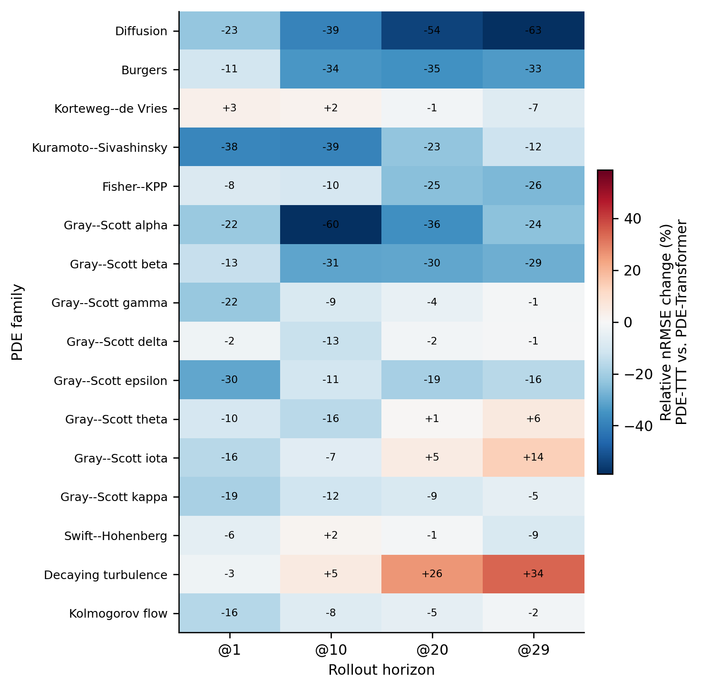
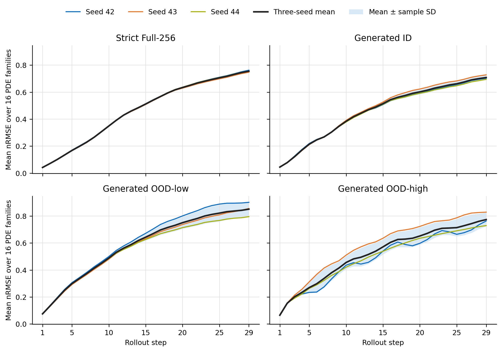

Predicting the next frame of a physical simulation is only the beginning. A neural model also has to work when its own prediction becomes the next input. A small error in the position of a wave, a vortex, or a reaction front can accumulate until the predicted trajectory follows a different evolution.

For my master's thesis, I explored whether changing how a model exchanges information across space could improve this repeated prediction process. The result is **PDE-TTT**, short for **PDE-Transformer with Full-Map Test-Time Training**. It keeps the multiscale structure of PDE-Transformer and replaces its window-attention mixers with temporary, input-dependent linear maps.

In the main Small-model experiment, PDE-TTT reduced trajectory-averaged error at the 29th prediction step by **15.48%**. A separate controlled benchmark at the same input resolution measured **6.15% lower training microbatch time** and **10.01% lower peak allocated GPU memory**. Those results came with a **0.52% increase in persistent parameters**. The interesting part is how a relatively small change to the spatial mixer produced that trade-off, and where it still failed.

[Project code](https://github.com/DuGuYifei/pde-transformer-ttt) · [Experiment evidence](https://github.com/DuGuYifei/pde-transformer-ttt/tree/train_history)

## The problem: predicting a field, then predicting from the prediction

A partial differential equation describes how quantities vary over space and time. Here, those quantities are represented as two-dimensional grids: for example, concentration fields in a reaction-diffusion system or flow fields in a fluid simulation.

The learned model receives the current field and a PDE-family identifier, then predicts the next field. At evaluation time, that prediction is fed back into the model. This continues for **29 autoregressive steps**, without replacing intermediate predictions with the reference solution. During training, however, the model only learns adjacent-state pairs using mean squared error.

This distinction matters. Good one-step predictions do not automatically lead to good trajectories. The model must repeatedly process states that gradually differ from its training inputs.


_A Gray-Scott epsilon example from the thesis. All rows start from the same field. PDE-TTT-S and PDE-Transformer-S are the internally trained raw models; the EMA and published-model rows are additional references with different checkpoint or training conditions. This is one illustrative trajectory, not an aggregate benchmark._

## Giving each block access to the whole field

The starting point is the [PDE-Transformer](https://github.com/tum-pbs/pde-transformer) U-shaped encoder-decoder developed by Holzschuh and colleagues. It processes features at several resolutions and combines them through skip connections. Its attention operates inside **8 × 8 windows**, with shifted windows allowing information to move between neighboring regions across blocks.

That is already much cheaper than dense global attention. With a fixed window size, its cost grows linearly with the number of spatial tokens. The question I wanted to explore was therefore about **spatial access**: could each block use information from its entire current feature map while keeping the computation practical?

PDE-TTT does this by compressing information from all spatial tokens into a small matrix for each sample and head. Every query then uses that matrix. At the highest-resolution stage of the Full-256 model, a 256 × 256 input becomes a 64 × 64 feature map after patch embedding. All 4,096 tokens contribute to the update, while each head's temporary matrix is only 32 × 32.

The encoder-decoder, conditioning, residual gates, and outer MLPs remain in place. All **22 blocks** use the new mixer. A 3 × 3 depthwise convolution supplies local positional information before mixing, with circular padding for the periodic domains used in the experiments. This makes the comparison a change to the spatial mixing design, including its positional treatment; it does not isolate one matrix operation from every surrounding component.

### What “test-time training” means here

Each block has a learned initial matrix, `W0`. Given the current features, it projects queries, keys, and values, constructs a sample-specific update from `KᵀV`, normalizes the update column by column, and applies the resulting matrix to the queries.

The core calculation is short enough to show directly:

```python
# q, k, v: [batch, heads, spatial_tokens, head_dim]
# w0:      [1, heads, head_dim, head_dim]
n = k.shape[-2]
gradient = -(k.transpose(-2, -1) @ v) / (3.0 * n)
gradient = gradient / (gradient.norm(dim=-2, keepdim=True) + 1.0)
fast_weights = w0 - inner_lr * gradient
output = q @ fast_weights
```

This is the update implemented in the project's [linear TTT mixer](https://github.com/DuGuYifei/pde-transformer-ttt/blob/5b3bf08c58ad8281f078301db5b78c814d61748f/pdetransformer/core/pde_vittt_global_linear.py), with an inner learning rate of 1 in the reported configuration. The matrix product combines all keys and values in the current stage. It avoids constructing a dense token-by-token global attention matrix.

The temporary weights exist only during that block call. They are **discarded before the next rollout step**, and evaluation never changes the persistent checkpoint parameters. The same mechanism is used during training, where gradients through the update teach the projections and `W0` how to produce useful fast weights.

So the adaptation is spatial and specific to the current input. The next solver call starts again from the learned initialization and the newly predicted field. No target labels or extra optimizer loop are required during inference.

## Why I ended up with a linear mixer

The final design emerged from an architecture study at 128 × 128 resolution. I tested linear and MLP learners inside windows, sequential updates over groups of window tokens, a local Attention-TTT hybrid, and a more expressive full-map ViT³-inspired model.

Several routes improved some horizons, but their costs and failure modes differed. Window TTT-Linear was fast yet slightly worse at longer horizons. Sequential window updates helped the linear learner but kept its spatial context local. The hybrid combined attention and TTT inside the same windows and incurred substantial extra cost without improving the longer rollout results.


_Exploratory architecture screen: lower and further left is better. The horizontal axis is end-to-end 29-step evaluation time on one GTX 1080 Ti; the vertical axis is step-20 mean nRMSE over 17 PDE families. These development runs guided selection; the main comparison uses separately trained Full-256 models._

The nonlinear full-map candidate achieved the lowest one-step error. The simpler full-map linear model achieved the lowest step-20 and step-29 errors in the retained screen, while taking **329.8 seconds** for evaluation versus **460.4 seconds** for the nonlinear candidate.

The surrounding network already provides nonlinear processing, conditioning, and multiple spatial scales. In these experiments, a compact global update worked well within that structure. Making the inner learner more elaborate did not consistently improve the complete solver.

## Testing the selected model under matched conditions

For the main experiment, I trained PDE-Transformer-S and PDE-TTT-S from random initialization on the Full-256 dataset. Both used the same data split, model seed, one-step objective, AdamW settings, and 100-epoch budget. Training used two GTX 1080 Ti GPUs in FP32, with an effective global batch size of 128.

The dataset covers **16 PDE families**. Its **850 strict-test trajectories** are disjoint from training and validation by simulation identifier or source file. Validation uses a transition-level split within the source trajectories, so it is less independent than the strict test.

Both main checkpoints were selected by minimum **raw validation MSE**. The PDE-TTT run also maintained an EMA shadow for a later study, but those shadow weights did not participate in its training forward passes or optimizer updates.

The table below follows the final thesis comparison and uses **trajectory-averaged normalized root mean squared error (nRMSE)**. Lower is better; `@29` means the error after 29 recursive predictions.

| Model | @1 | @10 | @20 | @29 |
| :--- | ---: | ---: | ---: | ---: |
| PDE-Transformer-S | 0.0534 | 0.4058 | 0.6884 | 0.8260 |
| **PDE-TTT-S** | **0.0482** | **0.3448** | **0.5861** | **0.6981** |
| Relative reduction | 9.77% | 15.04% | 14.86% | 15.48% |

The percentages are calculated from the unrounded results. The underlying checkpoint evaluations are retained for [PDE-Transformer-S](https://github.com/DuGuYifei/pde-transformer-ttt/blob/train_history/global-linear-full256-evaluation/plain_attention/full_test/results_cache_off.csv) and [PDE-TTT-S raw, seed 42](https://github.com/DuGuYifei/pde-transformer-ttt/blob/train_history/global-linear-s-rawbest-3seed-full256-evaluation/seed42/full_test/results_cache_off.csv).


_Replotted from the per-family evaluation records, weighted by the number of test trajectories, to use the same metric as the table. Points show the four reported horizons; the reductions use unrounded values. [Download the plotted data](/attachments/2026-11-08-AI-PDE-TTT/rollout-metrics.csv)._

PDE-TTT's error is lower at every reported horizon despite using only one-step supervision. A plausible explanation is that each block can use the complete current-stage field immediately, rather than relying on repeated cross-window communication. The results are consistent with that explanation, but establishing the mechanism would require further ablations.

### Looking past the average

At the final step, the raw PDE-TTT model improves **13 of 16 PDE families**. Diffusion shows the largest absolute reduction, from 0.7874 to 0.2914. Decaying turbulence is the clearest failure: error increases from 0.9540 to 1.2808. Gray-Scott theta and iota also favor the baseline at that horizon.


_Relative nRMSE change of PDE-TTT-S versus PDE-Transformer-S. Blue means lower PDE-TTT error; red means higher error. Values are rounded percentages._

Those exceptions matter for a solver. A lower average does not establish better conservation, more accurate energy spectra, or reliable behavior on every equation. This study measures field error; equation-specific physical diagnostics remain a useful next step.

## What happens to training cost?

I measured computation separately from prediction quality using synthetic 256 × 256 inputs, batch size 8, FP32, and one GTX 1080 Ti. Each measured microbatch includes forward and backward propagation; every eighth also includes an AdamW update. The results average two independent processes per architecture after warm-up.

| Metric | PDE-Transformer-S | PDE-TTT-S | Change |
| :--- | ---: | ---: | ---: |
| Training microbatch time | 329.974 ms | 309.694 ms | 6.15% lower |
| Throughput | 24.244 samples/s | 25.832 samples/s | 6.55% higher |
| Peak allocated GPU memory | 10,483.439 MiB | 9,434.329 MiB | 10.01% lower |
| Persistent parameters | 33,190,328 | 33,361,952 | 0.52% higher |

The memory reduction is about **1.02 GiB**, despite the slightly larger parameter count. The compact fast-weight matrices reduce intermediate storage in this workload. The [Full-256 benchmark report](https://github.com/DuGuYifei/pde-transformer-ttt/blob/train_history/efficiency-benchmarks/p-vs-global-linear-ttt/full256/report.md) records the individual runs and measurement protocol.

End-to-end training showed a smaller benefit: mean epoch time fell from 25.600 to 24.513 minutes, or 4.25%. Inference time was effectively unchanged, with differences below one percent. The measured advantage is therefore in training cost on this hardware; a general inference-speed claim would need additional experiments.

## Stability, parameter shifts, and a larger model

I also trained PDE-TTT-S with three model seeds and compared independently selected raw and exponential-moving-average checkpoints. EMA averages the persistent model parameters; it is separate from the temporary TTT weights. On the strict test, the step-29 family-mean nRMSE changed from **0.8278 ± 0.0324** for raw checkpoints to **0.7555 ± 0.0076** for EMA checkpoints, where the spread is sample standard deviation across the three training seeds.


_Three EMA-best models, evaluated on the same trajectories. Each curve averages the 16 trained PDE families. The shaded band describes model-seed variation; the baseline was not repeated with matching additional seeds._

A separately generated dataset changes physical parameters while pairing initial-condition seeds. It contains **153 trajectories**: 17 families, three conditions, and three initial-condition seeds. The conditions use an in-range parameter value and nearby values below or above the source range; Gray-Scott feed rates are perturbed by 5% around the named regime.

The raw PDE-TTT model has lower aggregate error in 11 of the 12 condition-horizon comparisons, but the advantage is uneven. At step 29, the reduction is 7.9% for ID, only 0.1% for OOD-low, and 11.7% for OOD-high. The extra hyper-diffusion family was absent from final training; removing it leaves reductions of 7.2%, 0.9%, and 10.6%. Seed variation also grows under shifts. These are limited parameter-perturbation experiments, with normalization statistics read from each evaluation file, rather than a test of unrestricted deployment adaptation.

Finally, the mixer remained trainable at **PDE-TTT-B**, with roughly 131 million parameters. Its EMA checkpoint had lower reported step-20 error on 14 of 16 families than the published PDE-Transformer-B reference. Because those models used different training pipelines, that comparison establishes feasibility at the larger width rather than a controlled architecture advantage.

## What I built, and what I would test next

The project includes the PyTorch mixer and backbone integration, configuration-driven training, raw and EMA checkpoint selection, strict-test evaluation, paired parameter-shift generation, and timing and memory benchmarks. The [implementation guide](https://github.com/DuGuYifei/pde-transformer-ttt/blob/5b3bf08c58ad8281f078301db5b78c814d61748f/docs/thesis-extension.md) maps the model entry points and experiment configurations. The evidence branch retains per-family results and training records so aggregate claims can be traced back to individual experiments.

My main takeaway is that **the spatial scope of the update deserves as much attention as the complexity of the inner learner**. In this setting, a small matrix built from the whole feature map gave a better overall trade-off than the more elaborate alternatives I tested.

The next experiments I would prioritize are paired multi-seed runs for both architectures, frozen training-set normalization, and interventions that exchange or restrict the fast weights. Those would help distinguish a repeatable architecture gain from checkpoint variation, and test how much of the benefit actually comes from sample-specific global information. Longer rollouts, physical diagnostics, and non-periodic or three-dimensional domains would then test how far the result extends beyond the current benchmark.

_Architecture diagrams and the other result figures are reproduced from my thesis assets; the trajectory-weighted rollout plot is replotted from the retained evaluation data. Quantitative comparisons here follow the final LaTeX results chapter: the seed-42 raw-best PDE-TTT-S checkpoint and the 256-resolution efficiency benchmark. The earlier development runs and their summaries use different checkpoints and should be read separately._
